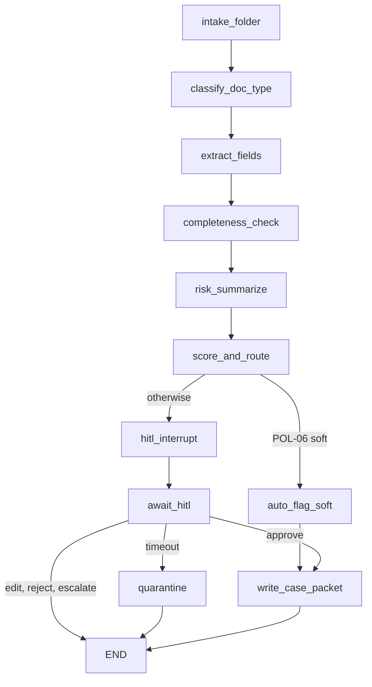

# UC-DR-01 LangGraph

Python LangGraph orchestration for the [UC-DR-01](https://ricklow.ai/uc-dr-01/) bank document-risk interview demo.

This repository is the fixture-backed graph. The clickable mock UI lives in a separate repo:

- Source: [kylow327-stack/uc-dr-01-demo](https://github.com/kylow327-stack/uc-dr-01-demo)
- Live UI: [uc-dr-01-demo.vercel.app](https://uc-dr-01-demo.vercel.app)

Public interview demo only. The packs under `fixtures/` are fictional. This is not a bank system, not a production Case/GRC integration, and not a signed-off control. No API key is required. Breaker example signals (`ex: …`) are illustrative design telemetry, not measured production KPIs.

## Hard rules

The graph enforces these. Tests lock them.

1. A soft flag never clears a regulatory obligation. The soft path writes `disposition = non_clearing_soft_flag` and `clearsRegulatoryObligation = false`.
2. HITL timeout quarantines. `approved` is false, no packet is written, and a timeout is never treated as approval.
3. Tier (`low` / `medium` / `high`) comes only from the policy table in `uc_dr_01/policy.py` (`POL-01` … `POL-06`). The narrative node cannot set it.
4. Extract and summary in v1 read fixtures. They do not call a model. A later summary model would still be ignored by `score_and_route`.

## Install

Python 3.11 or newer.

```bash
python3 -m venv .venv
source .venv/bin/activate
python -m pip install -e ".[dev]"
```

With uv:

```bash
uv venv
source .venv/bin/activate
uv pip install -e ".[dev]"
```

## Run

Soft path. `CASE-2041` is a complete low-tier pack. Policy row `POL-06` writes a simulated non-clearing packet:

```bash
python -m uc_dr_01 run --case CASE-2041
```

Look for `phase: soft_written`, `disposition: non_clearing_soft_flag`, and `clearsRegulatoryObligation: false`.

HITL wait. `CASE-2077` is missing a proof of address and the passport `expiry_date`. The graph pauses at the interrupt. Tier is `medium` from `POL-05`. No packet:

```bash
python -m uc_dr_01 run --case CASE-2077
```

Timeout. The same case, resumed with the timeout action, goes to quarantine. `approved` is false:

```bash
python -m uc_dr_01 run --case CASE-2077 --timeout
```

Pasted pack. `CASE-PASTE` is a `CASE-2041`-shaped sample with its own id. Any other JSON file in the same shape works the same way:

```bash
python -m uc_dr_01 run --fixture fixtures/cases/case-paste.json
```

Optional third folder. `CASE-2118` is the high tier (field confidence `0.62`, a name conflict, and a fixture elevated indicator: `POL-02`, `POL-03`, `POL-04`). It waits at HITL and does not write:

```bash
python -m uc_dr_01 run --case CASE-2118
```

`--action approve`, `edit`, `reject`, and `escalate` resume a waiting run. Approve writes an analyst-accepted packet that is still non-clearing. Edit does not write. `--timeout` on a case that never waits (such as `CASE-2041`) exits with an error and does not approve.

Stdout is one JSON document. Errors go to stderr.

## Graph



`await_hitl` uses LangGraph `interrupt`. The in-memory checkpointer holds the run until resume. Quarantine has no edge to the packet writer.

| Node | Role |
| --- | --- |
| `intake_folder` | Allow-list `cases/allow/<name>`. Reject anything else. |
| `classify_doc_type` | Map files to the frozen taxonomy. Unknown types force HITL. |
| `extract_fields` | Validate the fixture extract against the 0.90 floor. No model. |
| `completeness_check` | PACK-v1 required documents and fields. |
| `risk_summarize` | Ground the fixture briefing. Drop uncited factors and clearance language. Ignore a tier field. |
| `score_and_route` | Policy table only. |
| `auto_flag_soft` | Low, complete, no open breaker. |
| `write_case_packet` | Simulated packet. `clearsRegulatoryObligation` is false. |
| `hitl_interrupt` / `await_hitl` | Human gate. |
| `quarantine` | Timeout terminal. `approved: false`. No soft flag. |

An open breaker disables the soft path and does not change the tier. Half-open does not. `CB-CONFIDENCE` starts half-open in `fixtures/breakers.json`, so `CASE-2041` still takes the soft path. `CB-DATA-EGRESS` open kills the run with no packet. `CB-CASE-WRITE` open freezes an approve and does not approve. `CB-EXTRACT` open pauses extract.

## Policy table

Implemented in `uc_dr_01/policy.py`. First match wins on severity: high beats medium beats low. `POL-06` is the only soft route.

| Id | When | Tier | Route |
| --- | --- | --- | --- |
| POL-01 | File outside the taxonomy | high | HITL |
| POL-02 | Required field below 0.90 | high | HITL |
| POL-03 | Fixture identity conflict | high | HITL |
| POL-04 | Fixture elevated indicator | high | HITL |
| POL-05 | PACK-v1 document or field missing | medium | HITL |
| POL-06 | None of the above | low | soft |

## Tests

```bash
pytest
```

Covers the soft path (obligation stays uncleared), HITL timeout (quarantine, not approve), the policy table, and the three CLI flows.

## LangSmith

Tracing is optional. Leave `.env.example` commented and the demo runs with no key and no network.

To turn it on, copy `.env.example` to `.env`, set `LANGSMITH_TRACING`, `LANGSMITH_API_KEY`, and `LANGSMITH_PROJECT`, and install the extra:

```bash
python -m pip install -e ".[trace]"
```

LangGraph picks up `LANGSMITH_TRACING`, `LANGSMITH_API_KEY`, `LANGSMITH_PROJECT`, and `LANGSMITH_ENDPOINT` from the environment. The JSON field `tracing` is `off` unless `LANGSMITH_TRACING` is true. v1 does not require a live project. Do not point tracing at real customer documents.

`OPENAI_API_KEY` and `AZURE_OPENAI_*` are reserved for a later narrative model. v1 ignores them and uses the fixture briefing. The score node would ignore model output anyway.

## Layout

| Path | What it is |
| --- | --- |
| `uc_dr_01/graph.py` | StateGraph, HITL interrupt, quarantine, soft-flag write |
| `uc_dr_01/policy.py` | Deterministic tier table |
| `uc_dr_01/packet.py` | Non-clearing simulated packet |
| `fixtures/` | Fictional PACK-v1, taxonomy, breakers, and case packs |
| `fixtures/cases/case-paste.json` | Sample pack for `--fixture` |

## Not in this repo

- LangSmith Deployment or LangGraph Platform hosting
- Live document extraction or a required model call
- The Next.js / Vercel UI (see the demo repo above)
- Auth, payments, or a real bank connector
